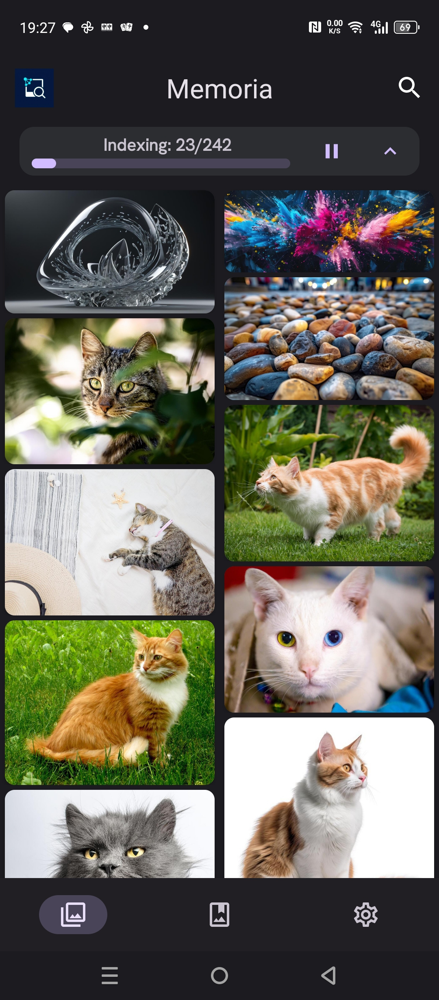
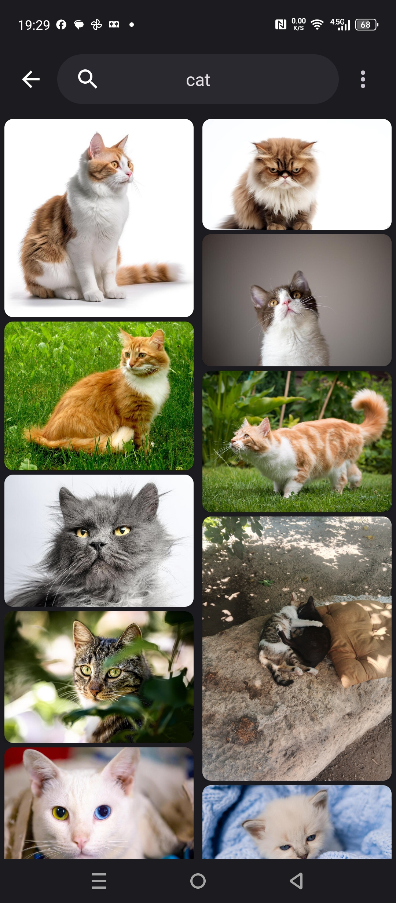
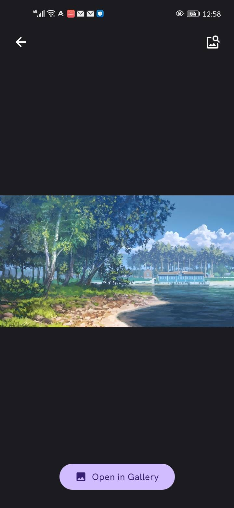
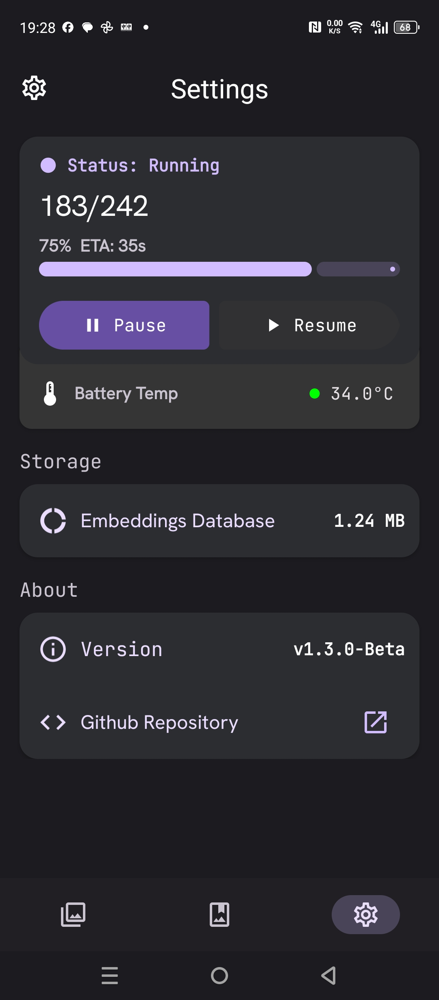
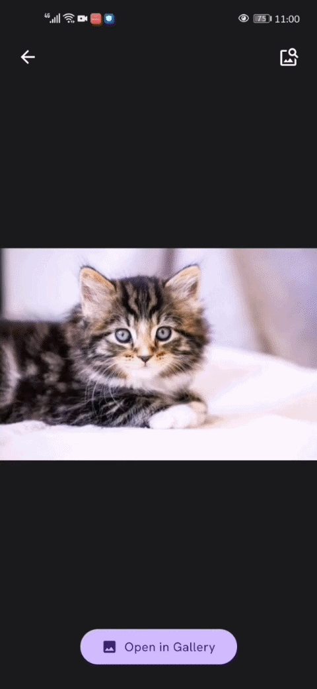
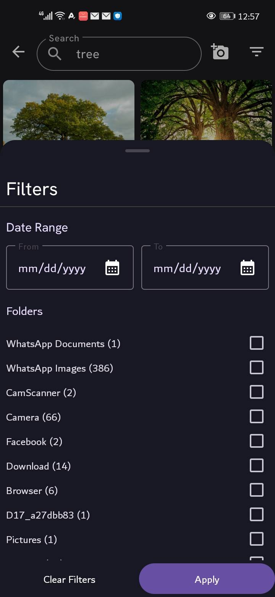

<div align="center">
  <a href="https://github.com/raslenabb12/Memoria">
    
  </a>

# Memoria

**Search your photos with words — or with a photo. No cloud. No account. No data leaving your phone.**

[](LICENSE)
[](https://android.com)
[](https://github.com/apple/ml-mobileclip)
[](https://github.com/raslenabb12/Memoria/releases)
[](https://github.com/raslenabb12/Memoria/stargazers)

[Screenshots](#screenshots) · [Features](#features) · [How it works](#how-it-works) · [Privacy](#privacy) · [Getting started](#getting-started) · [Roadmap](#roadmap) · [Contributing](#contributing)

</div>

---

## What is Memoria?

Memoria is an open-source Android app that lets you search your photo gallery using natural language — type *"dog at the beach"*, *"birthday cake"*, or *"snowy mountains"* and it finds the right photos instantly.

You can also search **with a photo instead of words** — pick one from anywhere, crop it to just the part you care about, or share an image from any other app straight into Memoria. Or open any photo and tap "Find Similar" to see more like it.

**Smart Albums (Experimental)** — create an album by name, seed it with a text search or a few reference photos, and Memoria will suggest similar photos to add as you keep indexing — all based on the same on-device embeddings.

Everything runs **100% on-device** using Apple's MobileCLIP-S0 model converted to TFLite. No internet connection required after setup. Your photos never leave your phone.

```
You type:  "my dog with a hat"          You show a photo of a chair
           ↓                                       ↓
    [MobileCLIP Text Encoder]           [MobileCLIP Image Encoder]
           ↓                                       ↓
    512-dimensional vector  ←──── same vector space ────→
           ↓
    cosine similarity search against indexed photo embeddings
           ↓
    ranked results
```

---

## Screenshots

|  |  |  |
|:---:|:---:|:---:|
| Non-blocking indexing progress | Search results | Full-screen photo viewer |

|  |  |  |
|:---:|:---:|:---:|
| Settings | Search by Image | Filters |

---

## Features

**Search**
- **Semantic photo search** — find photos by meaning, not metadata. "Sunset at sea" finds sunset photos even if they have no tags.
- **Multilingual search** — search in English, Arabic, French, Russian or Spanish. Queries are understood directly by the text encoder, with no translation step.
- **Search by photo** — pick one from anywhere and find visually similar photos in your gallery, no text needed.
- **Crop to search** — crop a photo down to just a face, an object, or one corner of the scene, and search with only that part.
- **Search from other apps** — share an image from any app, pick Memoria, and search your gallery without opening Memoria first.
- **Find Similar** — open any photo and find others like it with one tap, reusing the same embeddings your library is already indexed with.
- **Search history** — recent searches are saved so you can rerun them in one tap. Pin the ones you use often, delete a single entry, or clear everything at any time.
- **Confidence slider** — adjust the minimum match confidence for search results, from loose to strict.
- **Filters** — narrow search results by date range, folder, or camera make/model.

**Albums**
- **Smart Albums (Experimental)** — albums that suggest and track similar photos as your library grows, based on the average "look" of the album.
- **Seed albums your way** — start empty, from a text search, or from one or more reference photos of your choice.
- **Safe removal** — removing a photo from an album only affects that album, and every delete asks for confirmation first.

**Indexing**
- **Folder selection** — choose exactly which folders get indexed, so screenshots, icon packs, or downloads don't pollute your search results.
- **First-run onboarding** — guided permission request and folder selection when you first open the app.
- **Non-blocking indexing** — browse while indexing runs in the background, with a real progress bar and pause/resume support. The progress card collapses into a small toolbar indicator once indexing finishes. Indexing stays active with the screen off via a wake lock (only while the app remains open in the background).
- **Thermal-aware indexing** — automatically throttles during bulk indexing to avoid overheating your device.
- **Resilient indexing** — corrupted or unsupported images are detected and skipped instead of being retried on every run, and photos you delete from your gallery are removed from the index.

**General**
- **Small install** — the app is around 100 MB, with all models bundled.
- **Full-screen photo viewer** — tap any result to view it full-screen, swipe between results.
- **Settings screen** — live indexing status, storage breakdown, and a link back to this repo.
- **Open source** — Apache 2.0. Fork it, extend it, learn from it.

---

## How it works

Memoria uses **CLIP** (Contrastive Language–Image Pre-training), a neural network trained on 400 million image-text pairs. It maps both images and text into the *same* 512-dimensional vector space — meaning semantically similar things have similar vectors, regardless of whether they came from pixels or words. That shared space is what makes text search, search-by-photo, crop-to-search, and Find Similar all the same underlying operation:

```
Gallery photo  →  [Image Encoder]  →  512 floats  →  stored in Room DB
Search query   →  [Text  Encoder]  →  512 floats  ─┐
Search photo   →  [Image Encoder]  →  512 floats  ─┼─→  cosine similarity search
Cropped photo  →  [Image Encoder]  →  512 floats  ─┤
Find Similar   →  (reuse stored embedding)         ─┘
```

Smart Albums extend the same idea one level further: an album's embedding is the **normalized average** of its member photos' embeddings. New photos are compared against every album's average the same way a search query is compared against your library.

The model used is **MobileCLIP-S0** — Apple's mobile-optimized CLIP variant that achieves the same accuracy as OpenAI's ViT-B/16 while being 4.8× faster and 2.8× smaller.

As of v1.5.0 the text encoder's token embedding table is **quantized to int8 and built into the text encoder model itself**, which cut the app from about 280 MB to about 100 MB with no loss in search quality. The image encoder stays at fp16.

As of v1.7.0 the text encoder is a **custom-trained multilingual model** that understands English, Arabic, French, Russian and Spanish, paired with a **SentencePiece tokenizer** that handles Arabic and Cyrillic scripts, accents and punctuation. It maps queries into the same space as the image encoder, so existing photo indexes keep working without a reindex.

| Component | Details |
|---|---|
| Image encoder | MobileCLIP-S0 → TFLite, fp16 |
| Text encoder | Custom-trained multilingual text encoder (English, Arabic, French, Russian, Spanish) → TFLite, int8 |
| Tokenizer | SentencePiece (`spm.model`), 77-token context |
| Embedding dim | 512 floats per image/query |
| Similarity | Cosine similarity (L2-normalized dot product) |
| Cropping | [uCrop](https://github.com/Yalantis/uCrop) |
| DB | Room |

---

## Privacy

- No `INTERNET` permission, so the app cannot make network requests at all.
- No account, no analytics, no ads.
- App data is excluded from Android's automatic system backups. Your photo index and search history stay on the device. If you move to a new phone, Memoria reindexes your photos there.
- Search history is stored locally and can be deleted per item or cleared entirely from the app.

---

## Getting started

### Requirements

- Android 9.0+ (API 28)
- Enough free storage for the app (~100 MB) plus the local index, which grows with your library (about 126 MB for a 30,000-photo library)
- 3 GB+ RAM recommended

### Install

Grab the latest APK from the [Releases page](https://github.com/raslenabb12/Memoria/releases). Updates keep your existing index and albums, so you usually don't need to reindex. Check the release notes for any version that says otherwise.

### Build from source

```bash
git clone https://github.com/raslenabb12/memoria.git
cd memoria
```

The model files are included in the repository, in `app/src/main/assets/`:

```
mobileclip_s0_image_v2.tflite   (image encoder)
text_encoder_int8w.tflite       (multilingual text encoder)
spm.model                       (SentencePiece tokenizer model)
```

Then open in Android Studio and run.

---

## Roadmap

- [x] Settings screen (indexing status, storage info)
- [x] Search filters — date range, folder, camera make/model
- [x] Search by photo
- [x] Find Similar
- [x] Folder selection (index only chosen folders instead of the full library)
- [x] Pause/resume control for indexing
- [x] First-run onboarding flow
- [x] Confidence threshold slider for search results
- [x] Smart Albums (experimental)
- [x] Create albums from reference photos
- [x] Smaller app size (int8 text encoder)
- [x] Crop-to-search
- [x] Search from other apps via the share sheet
- [x] Search history with pinned searches
- [ ] Duplicate / near-duplicate photo detection
- [x] Manually add any photo to an album
- [ ] Native in-app media actions (move, copy, delete)
- [ ] F-Droid distribution

---

## Contributing

Issues and PRs are welcome. Use the bug report form when you file an issue: your device, Android version, app version, and roughly how many photos are in your library help a lot, and so does a screen recording or logcat output. For questions and feature ideas, use [Discussions](https://github.com/raslenabb12/Memoria/discussions).

Memoria is a solo project maintained alongside my studies, so updates may be slower during the school year.

---

## License

Code is licensed under Apache 2.0 — see [LICENSE](LICENSE). The bundled MobileCLIP-S0 model is subject to [Apple's ML Research Model Terms of Use](https://github.com/apple/ml-mobileclip/blob/main/LICENSE_MODELS).
